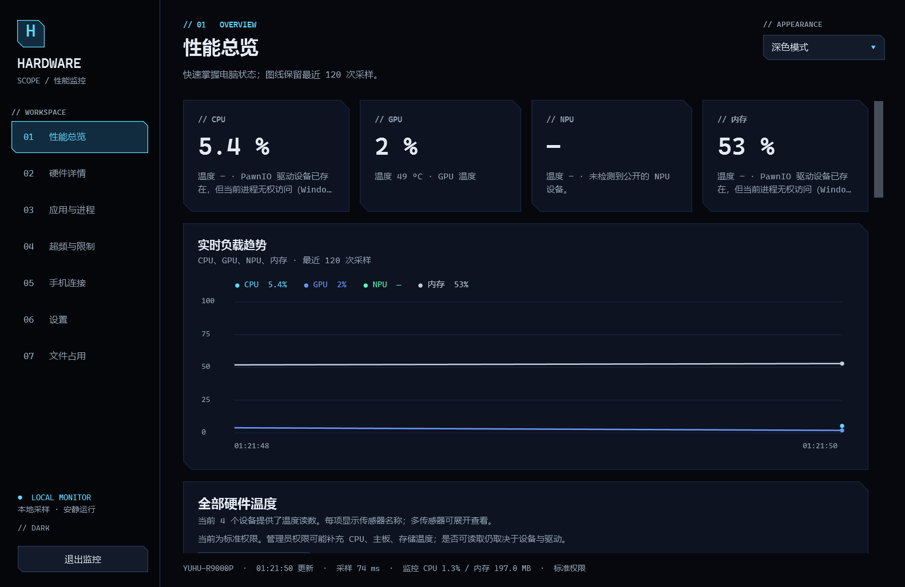
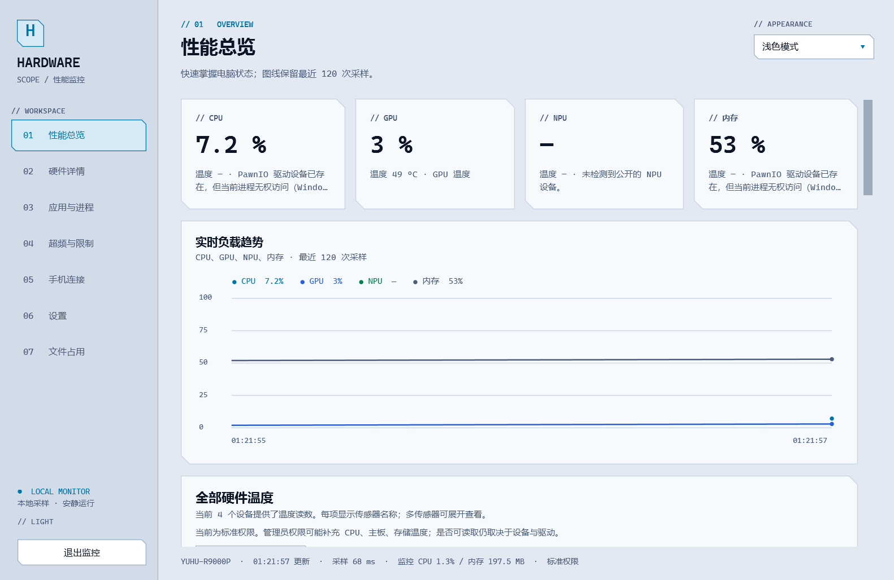
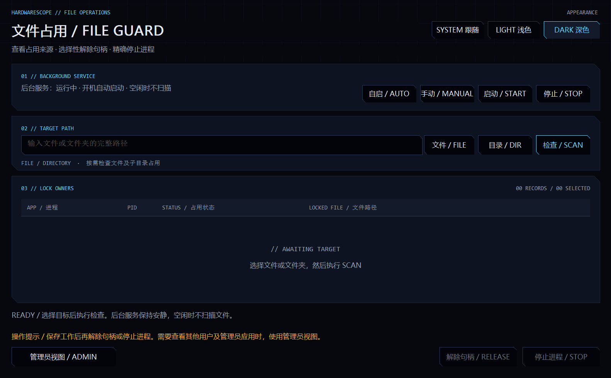

# HardwareScope 硬件视界

原生 Windows 硬件与性能监控软件，以及原生安卓远程客户端。Windows 界面提供性能总览、硬件详情、应用与进程、超频与限制、手机连接、设置和文件占用七页；安卓端提供监控数据、设置和已授权的进程操作。

HardwareScope 1.2.0 与 FileGuard 1.1.0 使用重新设计的原生界面：清晰的侧栏导航、紧凑的指标卡、温度列表和趋势图，支持浅色、深色、跟随系统三种主题。Windows 改变应用颜色模式时，跟随系统的窗口会即时更新。界面参考 KUNLUN 的色彩和布局，由 WPF 与 Win32 原生控件实现；使用系统自带的微软雅黑和 Consolas，没有下载网络字体或复制上游组件。详细设计与实现见 [界面与主题](docs/界面与主题.md)。

## 安装与使用

从 [GitHub 最新发布](https://github.com/YUHU-1st/HardwareScope/releases/latest) 下载 Windows 完整安装程序、免安装 ZIP 或 FileGuard 轻量独立安装程序；同一发布提供源码和验证记录。1.2.0 本地交付文件位于 `artifacts/release/1.2.0`。完整 Windows 包包含 .NET 运行库；FileGuard 1.1.0 是原生程序，不需要 .NET。安卓客户端沿用 1.0.1，要求 Android 8.0 及以上。

「文件占用」页可查询文件和文件夹占用，打开独立模块，选择释放文件句柄或结束进程。完整安装程序默认安装右键菜单和安静后台服务，需要管理员授权；Windows 11 的右键项位于「显示更多选项」。FileGuard 服务可设置开机自启，空闲时不扫描、不弹窗口或终端，关闭性能监控后仍可使用。释放句柄和结束进程都可能丢失未保存数据，确认前请先保存工作。详细行为和限制见 [文件占用模块](docs/文件占用模块.md)。

启动 Windows 客户端即可查看实时采样。在硬件详情选择分类、设备和指标，可查看来源、可用性及历史曲线；在应用与进程页点击列标题排序，选择进程后设置 CPU 调度优先级或结束该进程。结束前会要求确认，实例变化后必须重新选择。

总览的「设备温度」按每台设备显示温度，覆盖主板、CPU、GPU、NPU、内存、显存、存储和网卡；多温度显示传感器名称，可点击查看对应曲线。温度缺失时显示具体原因，不会用频率或零值代替温度。CPU 温度和底层功耗需要授权时，可直接在总览点击「以管理员身份重新打开」；当前电脑已实测读到 CPU Tctl/Tdie、CCD 温度、功耗、核心频率及两块 SSD 温度。没有 NPU、设备未开放温度或虚拟网卡没有物理传感器时仍会明确说明。

管理员身份可尝试访问更多底层传感器，也会启用分进程 TCP/UDP 网络事件采集。普通权限仍能读取 CPU 负载、系统报告频率、内存、GPU、显存、网卡和多数进程信息。硬件、驱动或权限不支持的数据会明确标为空；不会关闭 Windows 的驱动安全保护。

「设置」可选择 1、2、5、10 秒采样，开启登录自启或关闭窗口后保留在托盘。默认两秒、不开机自启、关闭窗口继续监控。完全停止请点击「退出监控」或托盘菜单中的退出项。托盘后台应用在当前登录会话内运行，不是注销后继续工作的 Windows Service。

在「设置」中选择浅色、深色或跟随系统主题，选择会保存在本机。FileGuard 窗口也可选择主题；后台服务不创建界面，不参与主题刷新。主题切换由设置事件通知驱动，不增加定时轮询或改变硬件采样频率。

## 连接手机

1. 在电脑端「手机连接」启用 HTTPS，按需要允许手机控制。
2. 手机和电脑连接同一局域网。在电脑地址列表选择手机可到达的网卡地址；多网卡时不要选 VMware 等仅电脑内部使用的地址。
3. 在安卓端输入这个 HTTPS 地址、电脑证书的 SHA-256 指纹和连接密钥，然后连接。密钥默认隐藏，可在电脑端显示或复制；重置密钥会撤销原手机授权。
4. 防火墙询问时允许可信的专用网络。如果无法连接，可在管理员 PowerShell 执行安装目录内 `scripts/Enable-LanFirewall.ps1 -ExecutablePath '实际路径\HardwareScope.exe'`；该脚本只放行专用网络的局域网 TCP 端口。手机 Wi-Fi 的客户端隔离也可能阻止连接。

蓝牙连接：先在 Windows 与 Android 系统设置中配对，在电脑端开启蓝牙服务，再在安卓端选择已配对的电脑并输入连接密钥。Android 12 及以上需要授予附近设备权限。蓝牙使用独立 RFCOMM 服务 UUID `9174d900-1895-4d3e-a219-3a1927f05b81`，逐请求认证。

安卓应用退到后台会暂停轮询；回到前台恢复。电脑必须保持在线，手机控制权限可由电脑端关闭。证书指纹与密钥保存在本机受保护存储内，不依赖在线账号。

本版本的 HTTPS 也可使用已有 VPN / 私有组网地址；没有代替用户部署跨网中继。vivo SDK 的公开接口、机型范围与接入结论见 [vivo 跨网接入可行性](docs/vivo跨网接入可行性.md)。

## 数据与验证边界

CPU 睿频和 GPU Boost 不直接判为超频。NVIDIA 驱动支持时显示可验证的核心、显存 MHz 偏移；未公开基准时不伪造超频百分比。正在运行的调优软件是线索，不能证明当前设置由它写入。

主板、CPU、NPU 等传感器支持取决于设备与驱动。未发现 NPU 与发现设备但不能读取传感器分别说明；GPU 神经运算不会直接冒充独立 NPU。进程 I/O 包含文件与设备访问，不当作纯磁盘或网络吞吐。

Windows 实机、加密 API、进程控制、安卓传输代码及 APK 构建已经验证；安卓真机界面、Keystore、实际蓝牙配对和跨网连接没有在现有手机上实测。本次主题、文件占用服务及安装升级的复验结果见 [1.2.0 界面更新验证](docs/界面更新验证.md)；详细传感器能力及测试覆盖见 [指标说明](docs/指标说明.md)、[验证报告](docs/验证报告.md) 和 [安卓验证](android/VALIDATION.md)。

## 设置与源码

Windows 设置保存在 `%LOCALAPPDATA%\HardwareScope`，保存前保留 `settings.json.bak`；证书私钥和访问密钥使用 Windows DPAPI 保护。卸载保留这些用户数据，需要清理时先备份。Android 使用 Keystore AES-GCM 保护访问密钥，并禁止连接偏好的系统备份与设备迁移。

Windows 使用 .NET 10、WPF、LibreHardwareMonitor、NVML、PDH 和 Windows ETW。安卓使用 Kotlin 和原生 Android View，不包含 WebView、浏览器运行时或大型 UI 框架。

Windows 构建：安装 .NET 10 SDK、Visual Studio 2022 C++ Build Tools、Windows SDK 与 Inno Setup 6 后执行 `pwsh -File scripts/build-windows.ps1`。只构建 FileGuard 可执行 `pwsh -File scripts/build-fileguard.ps1`。安卓构建见 [安卓 README](android/README.md)；发布签名密钥保存在本机 `android/signing`，请独立离线备份，这个目录没有放入公开仓库或源码 ZIP。

公开源码排除构建产物、签名私钥、本地 SDK 配置、监控设置和手机连接凭据。`android/app/src/test/resources/https-test.p12` 是仅用于回环地址 HTTPS 单元测试的公开测试证书，不能用于正式服务或发布签名。第三方组件及来源见 [第三方声明](THIRD_PARTY_NOTICES.md)。

完整解决方案是 `HardwareScope.sln`。`tests/HardwareScope.Smoke` 使用隔离配置、临时本机端口和一次性子进程，验证数据、认证、证书、撤销授权、优先级、结束进程、设置和关闭流程，不操作用户现有应用。
