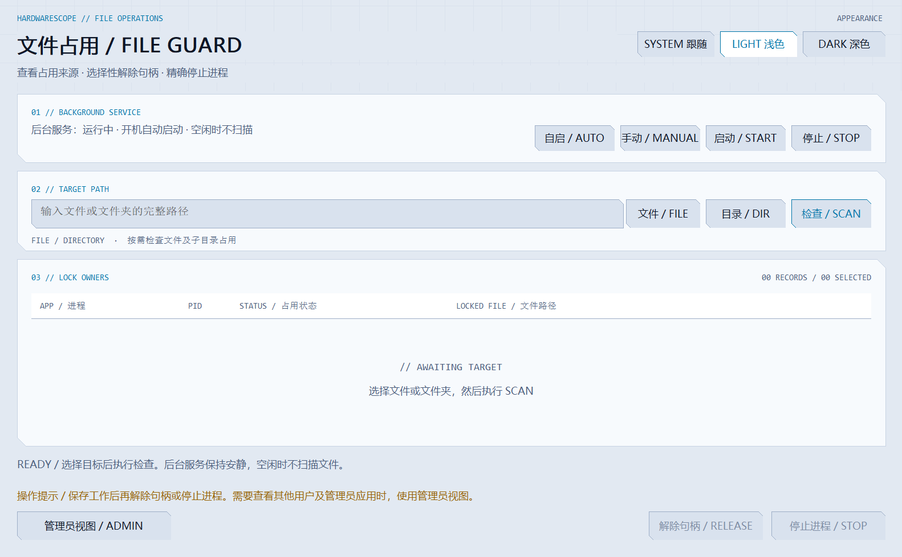

# HardwareScope 界面与主题

HardwareScope 1.2.0 与 FileGuard 1.1.0 采用重新设计的原生 Windows 界面。主程序由 WPF 绘制，轻量独立模块由 Win32 绘制；不引入浏览器、WebView 或网络字体。

## 设计来源

界面的色彩和布局参考 yoruuuchan 的 [KUNLUN Design System](https://github.com/yoruuuchan/yoru-design-systems/tree/main/KUNLUN%20Design%20System) 与其 [设计说明](https://github.com/yoruuuchan/yoru-design-systems/blob/main/KUNLUN%20Design%20System/SKILL.md)：青蓝色主强调、切角面板、紧凑的指标分区与侧栏导航，警告和危险分别使用少量琥珀色及红色。HardwareScope 的控件、布局和绘制代码按本软件的硬件监控及文件占用功能重新实现，没有复制上游 UI 组件、应用代码、标志、字体或网页资产。中文使用 Windows 自带的微软雅黑，数字和技术标签使用 Consolas，替代上游网络字体。来源声明见 [第三方声明](../THIRD_PARTY_NOTICES.md)。

## 三种主题

| 模式 | 行为 |
|---|---|
| 跟随系统 | 使用 Windows 的应用颜色模式；系统切换浅色或深色后更新当前窗口。 |
| 浅色 | 始终使用浅色背景、深色正文和青蓝色强调。 |
| 深色 | 始终使用深色背景、浅色正文和青蓝色强调。 |

主题可在主程序「设置」页和 FileGuard 窗口中选择，两者共享当前 Windows 用户的外观偏好。默认跟随系统；手动选择浅色或深色后，Windows 颜色模式变化不会覆盖选择，恢复「跟随系统」后重新应用当前系统模式。主题只改变界面，不改变采样间隔、后台服务启动方式、连接权限或进程操作权限。

主题覆盖导航、标题、指标卡、正文、按钮、输入框、列表和图表。可用与不可用指标同时保留文字说明，状态颜色不代替读数、传感器来源或缺失原因。

## 轻量更新方式

主题保存在 `HKCU\Software\HardwareScope\Appearance` 的 `Theme` DWORD：`0` 为跟随系统，`1` 为浅色，`2` 为深色。更改前将旧值保存到 `ThemeBackup`。写入后广播通过 `RegisterWindowMessage` 注册的 `HardwareScope.AppearanceChanged.v1` 消息，让已打开的主程序和独立模块更新共享偏好。

系统模式从 Windows 的 `AppsUseLightTheme` 设置读取。FileGuard 窗口处理 `WM_SETTINGCHANGE`，WPF 使用 Windows 设置变化消息与 `SystemEvents` 通知刷新颜色。用户选择主题时直接更新当前窗口，不额外建立轮询线程、主题定时器或后台扫描。程序关闭时解除事件订阅；FileGuard 后台服务没有窗口，不加载界面主题，也不监听外观变化。

WPF 使用统一的颜色资源更新控件，趋势图按当前主题绘制。FileGuard 只在窗口存在时处理 Windows 外观通知并重绘控件。两种界面都保留原有采样和按需查询方式；切换主题不增加硬件读取或文件句柄枚举。

## 界面预览

截图展示布局和主题，截图中的硬件与占用信息只代表拍摄时的设备状态。安装包可从 [GitHub 最新发布](https://github.com/YUHU-1st/HardwareScope/releases/latest) 下载。
